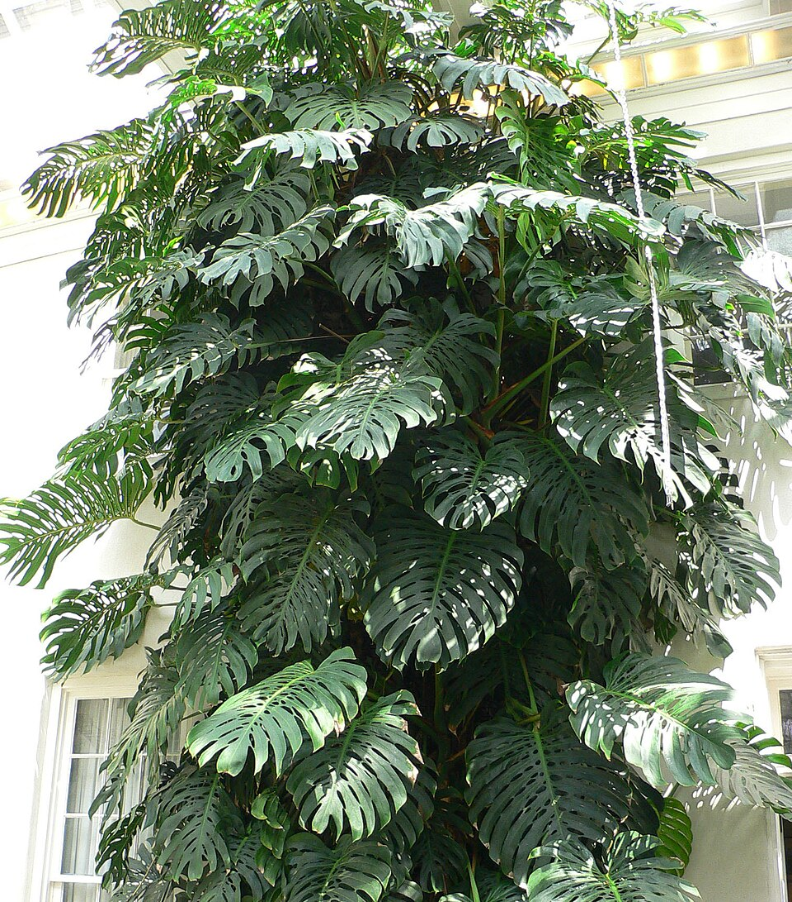
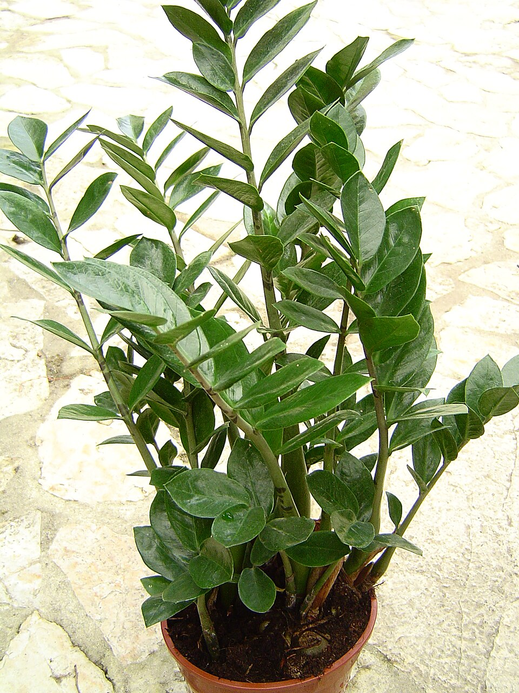

<div align="center">


# PlantAI

**Identify Plants. Understand Nature. Grow With Confidence.**

An AI-assisted plant identifier and plant-care companion — built with Next.js,
TypeScript, Supabase and Pl@ntNet integration.

[](https://nextjs.org/)
[](https://react.dev/)
[](https://www.typescriptlang.org/)
[](https://tailwindcss.com/)
[](https://supabase.com/)
[](https://www.netlify.com/)
[](TESTING_PLAN.md)

**AI plant identification · Plant recognition · Houseplant care · Gardening technology**

</div>

---

## Table of Contents

- [What is PlantAI?](#what-is-plantai)
- [Live Demo](#live-demo)
- [Key Features](#key-features)
- [How Plant Identification Works](#how-plant-identification-works)
- [Supported Plant Library](#supported-plant-library)
- [Technology Stack](#technology-stack)
- [Architecture Overview](#architecture-overview)
- [Screenshots](#screenshots)
- [Local Installation](#local-installation)
- [Environment Variables](#environment-variables)
- [Netlify Deployment Guide](#netlify-deployment-guide)
- [SEO and Performance](#seo-and-performance)
- [Project Roadmap](#project-roadmap)
- [Privacy and Security](#privacy-and-security)
- [Limitations and Current Status](#limitations-and-current-status)
- [Contributing](#contributing)
- [Contact and Links](#contact-and-links)

---

## What is PlantAI?

PlantAI is a web application for **plant identification and plant care**. Point
your camera at a houseplant, upload a photo of a leaf or flower, and PlantAI
helps you recognize the species and learn how to care for it — light, water,
soil, and common problems.

The project pairs an **AI plant identification pipeline** (Pl@ntNet-compatible)
with a curated **houseplant library** of ten popular indoor species, each with
verified photographic assets and structured care information. It is aimed at
beginners who want a trustworthy indoor plant care guide as well as gardeners
who want a fast plant identifier.

PlantAI is built **zero-budget-first**: free hosting (Netlify Free), a free
provider subdomain, no paid dependencies, and honest, truthful product states
throughout. Everything described here is real, inspected source code — the
[status section](#limitations-and-current-status) is kept honest about what
works today and what is still coming.

---

## Live Demo

<div align="center">

### 🌿 [**Open the live PlantAI application**](https://strong-mochi-e3869f.netlify.app)

**https://strong-mochi-e3869f.netlify.app**

</div>

The live app currently runs in **demo (mock) identification mode** —
identification is fully interactive, with results clearly labeled as demo
results. See [Limitations and Current Status](#limitations-and-current-status)
for exactly what is switched on and what is deliberately off.

---

## Key Features

**Implemented today** (all verifiable in the source code):

- **Image-based plant identification pipeline** — upload or take 1–3 photos
  and get species matches with confidence scores, service coverage, and
  structured results.
- **Live camera capture** — in-browser photo capture via the standard
  `navigator.mediaDevices.getUserMedia` API, with graceful fallback to file
  upload on unsupported devices.
- **On-device image optimization** — large photos are automatically re-encoded
  in the browser (≤ 2048 px, quality ladder) before upload, keeping requests
  well inside the hosting platform's request-size limits. If optimization is
  unavailable, the original file continues through normal validation — no
  image is silently discarded.
- **Mock identification provider** — a fully offline provider used by default
  so the whole experience can be developed and tested without external
  services or API keys.
- **Pl@ntNet API v2 integration code** — a live provider implementation is
  ready and reviewed; activation is an explicit, owner-controlled decision.
- **Image upload validation** — MIME/type checks, size limits, and safe
  handling before any image is processed.
- **Plant library and search** — a curated catalog of ten houseplant species
  with local, license-verified photography and on-page search.
- **Plant species detail pages** — structured care information, imagery with
  attribution, and shareable URLs for every species.
- **User authentication** — email sign-up, sign-in, password reset, and email
  confirmation flows built on Supabase Auth.
- **Saved plants** — logged-in users can save identification results to their
  account (server actions with validation).
- **User dashboard** — a personal overview for saved plants and activity.
- **Contact functionality** — validated contact form with a server action and
  rate limiting.
- **Real plant photography with attribution** — every image renders its
  credit line, visible on the species detail page.
- **Responsive, mobile-first UI** — bottom navigation and adaptive layouts;
  PWA-ready manifest.
- **SEO foundations and structured data** — `robots.txt`, `sitemap.xml`,
  JSON-LD structured data, Open Graph/Twitter cards with a branded share
  image, and security headers.

**Truthful "coming soon" states** (UI exists, functionality intentionally
pending — no fake data):

- **My Plants** — personal plant collection management (Phase 4 scope).
- **Reminders** — watering and care reminders (Phase 4 scope).

---

## How Plant Identification Works

The identification pipeline is designed around a single provider contract so
that mock and live modes behave identically from the application's point of
view:

1. **Input** — 1–3 photos of the *same* plant, from the camera or a file
   upload (optionally hinting the organ: leaf, flower, fruit, bark, or auto).
2. **On-device optimization** — files above ~1.5 MB are re-encoded in the
   browser before upload (`src/lib/identify/image-compression.ts`).
3. **Validation** — MIME type, size, and dimension checks
   (`src/lib/identify/image-validation.ts`); the server re-validates
   everything the client checks.
4. **Deduplication** — recent identical requests are short-circuited by a
   cache (`src/lib/identify/dedup-cache.ts`) to protect quota.
5. **Provider** —
   - `MockPlantnetProvider` — deterministic, offline results (default).
   - `PlantnetLiveProvider` — Pl@ntNet API v2 with a server-only API key.
6. **Normalization** — both providers produce the same normalized result
   shape (`src/lib/plantnet/normalize.ts`), covered by parity tests.
7. **Output** — ranked species suggestions with scores, plus attribution and
   service metadata.

Enabling live identification requires a single server-only variable:
`PLANTNET_API_KEY` (from `my.plantnet.org → settings → API key`). When it is
present the app uses the live Pl@ntNet provider; when it is missing or blank
the API returns a clean "not available right now" response in production, and
local development/test falls back to deterministic sample data. See
[`AI_INTEGRATION_PLAN.md`](AI_INTEGRATION_PLAN.md) and
[`API_DOCUMENTATION.md`](API_DOCUMENTATION.md).

---

## Supported Plant Library

The built-in houseplant guide covers ten popular indoor species, each with a
detail page including structured care information and attributed photography:

| Species | Common name |
| --- | --- |
| `aloe-vera` | Aloe Vera |
| `crassula-ovata` | Jade Plant |
| `dracaena-trifasciata` | Snake Plant |
| `epipremnum-aureum` | Golden Pothos |
| `ficus-elastica` | Rubber Plant |
| `ficus-lyrata` | Fiddle-Leaf Fig |
| `monstera-deliciosa` | Monstera / Swiss Cheese Plant |
| `philodendron-hederaceum` | Heartleaf Philodendron |
| `spathiphyllum-wallisii` | Peace Lily |
| `zamioculcas-zamiifolia` | ZZ Plant |

Photography was verified against the named species and recorded with source
and license information in [`docs/IMAGE_CREDITS.md`](docs/IMAGE_CREDITS.md).
The database's canonical `plant_library.image_url` always wins when present;
the bundled registry acts as a verified fallback display source.

---

## Technology Stack

| Layer | Technology |
| --- | --- |
| Framework | Next.js 16.4.6 (App Router, Turbopack, Cache Components) |
| UI library | React 19.3.0 |
| Language | TypeScript (strict mode) |
| Styling | Tailwind CSS 4.3.3 (CSS-first tokens) |
| Database & Auth | Supabase (PostgreSQL, Auth, Storage) |
| Identification | Pl@ntNet-compatible provider pipeline (mock default) |
| Validation | Zod |
| Testing | Vitest — 197 passing tests |
| Linting / Formatting | ESLint 9 (flat config) + Prettier |
| Hosting | Netlify Free (OpenNext-based Next.js runtime) |

---

## Architecture Overview

PlantAI follows a modern, server-first Next.js architecture. A detailed
write-up lives in [`ARCHITECTURE.md`](ARCHITECTURE.md); the short version:

- **App Router pages** organized by route groups: public pages, authenticated
  user pages (`/dashboard`, `/my-plants`, `/saved-plants`, `/reminders`),
  and auth pages (`/login`, `/signup`, password recovery).
- **Server actions** (`src/actions/`) handle mutations — saving plants and
  contact submissions — with Zod validation and rate limiting.
- **Provider-based identification** (`src/lib/plantnet/`) — a shared
  `PlantnetProvider` interface with `MockPlantnetProvider` (default) and
  `PlantnetLiveProvider` (Pl@ntNet API v2), plus response normalization and
  organ handling.
- **Supabase data layer** — PostgreSQL schema with row-level security,
  migrations under `supabase/migrations/`, and SSR-authenticated clients.
- **Environment-gated behavior** (`src/lib/env.ts`) — mock vs. live mode and
  identification persistence are explicit configuration decisions, never
  implicit defaults.

---

## Screenshots

No application screenshots have been published yet — they will be added here
after the initial public launch, captured from the real running app. What we
*can* show honestly today is the bundled plant-library imagery that ships
with the app — real, license-verified photographs of the species in the
catalog:

| | | |
| --- | --- | --- |
|  |  |  |
|  |  |  |

Image credits and license details are documented in
[`docs/IMAGE_CREDITS.md`](docs/IMAGE_CREDITS.md), and the attribution line is
rendered wherever an image appears in the app.

---

## Local Installation

Prerequisites: **Node.js 20+** (Node 24 recommended) and **npm**. These
instructions are for Windows PowerShell.

```powershell
# 1. Clone the repository
git clone https://github.com/Sohail-AI-Architect/PlantAI.git
cd PlantAI

# 2. Install dependencies
npm install

# 3. Create your local environment file (never commit it)
Copy-Item .env.example .env.local

# 4. Start the development server
npm run dev
```

Then open <http://localhost:3000>.

> The app runs fully in **mock mode** out of the box — no Supabase or
> Pl@ntNet credentials are required to explore the UI, the plant library, and
> the mock identification flow. Connecting Supabase enables auth and
> persistence features; see [Environment Variables](#environment-variables).

---

## Environment Variables

Copy `.env.example` to `.env.local` and fill in your own values. **Never
commit `.env.local`** — it is already excluded via `.gitignore`.

| Variable | Purpose |
| --- | --- |
| `NEXT_PUBLIC_SITE_URL` | Canonical site URL used for SEO metadata |
| `NEXT_PUBLIC_SUPABASE_URL` | Supabase project URL (publishable) |
| `NEXT_PUBLIC_SUPABASE_PUBLISHABLE_KEY` | Publishable (anon) key for browser clients |
| `SUPABASE_SECRET_KEY` | Server-only Supabase secret key |
| `PLANTNET_API_KEY` | Server-only Pl@ntNet API key — set it to enable live identification |
| `PLANTNET_MODE` | Optional; only used to warn when set to `live` without a key |
| `PLANTAI_PERSISTENCE_ENABLED` | `OFF` (default) or `true` — persistence gate |
| `IP_HASH_SALT` | Salt for privacy-preserving IP hashing in rate limiting |

Step-by-step guidance, including where each Supabase value comes from, is in
[`ENVIRONMENT_SETUP.md`](ENVIRONMENT_SETUP.md). Real secret values are never
published in this repository.

---

## Netlify Deployment Guide

PlantAI runs on **Netlify Free** (commercial use is explicitly permitted on
Netlify's free tier) with **zero custom configuration** — Netlify
auto-detects Next.js and installs its official adapter.

1. **Create a free Netlify account** (GitHub sign-in, no credit card) and
   `Add new site → Import an existing project → GitHub → PlantAI`.
2. **Accept the auto-detected settings** — build command `npm run build`; do
   not change the publish directory or add plugins.
3. **Add environment variables** (Site configuration → Environment variables,
   scope: all scopes) **before** the build that goes public — the Supabase
   URL is consumed at build time for the Content-Security-Policy. Use the
   [Environment Variables](#environment-variables) table; for production set
   `NEXT_PUBLIC_SITE_URL` to the final `*.netlify.app` URL and add
   `PLANTNET_API_KEY` so `/identify` uses live Pl@ntNet results.
4. **Deploy**, then trigger a fresh deploy after setting the final site URL.
5. **Verify** post-deploy: HTTPS, all routes, `/robots.txt`, `/sitemap.xml`,
   security headers, and the identification flow.

The complete pre-deployment preparation, environment-variable scopes, and
platform limits: Netlify auto-detects Next.js (build command `npm run build`,
no `netlify.toml` needed); the production environment variables are listed in
the Environment Variables section above.

---

## SEO and Performance

SEO foundations implemented in the codebase:

- `robots.txt` and `sitemap.xml` generation (`src/app/robots.ts`,
  `src/app/sitemap.ts`) — only canonical, indexable public pages.
- Per-route metadata with canonical URLs from `NEXT_PUBLIC_SITE_URL`
  (per-species and per-article metadata on dynamic routes).
- JSON-LD structured data — `WebSite` + `SoftwareApplication` on the home
  page, `BreadcrumbList` on species and article pages
  (`src/components/seo/json-ld.tsx`).
- Open Graph and Twitter/X cards with a branded share image
  (`public/og-image.jpg`, generated by `scripts/generate-og-image.mjs` from
  existing project branding).
- PWA web manifest (`src/app/manifest.ts`) and self-hosted font loading.
- Security headers documented in
  [`docs/SECURITY_HEADERS_PROPOSAL.md`](docs/SECURITY_HEADERS_PROPOSAL.md).
- Performance practices: server-first rendering, on-device image
  optimization before upload, `next/image` with responsive `sizes`.

The broader organic-growth plan (keywords, editorial calendar, and the role
of the Garden Guide blog) lives in
[`SEO_STRATEGY.md`](SEO_STRATEGY.md) and
[`CONTENT_STRATEGY.md`](CONTENT_STRATEGY.md).

---

## Project Roadmap

The authoritative plan is [`DEVELOPMENT_ROADMAP.md`](DEVELOPMENT_ROADMAP.md);
the current high-level picture:

1. **Public launch readiness:** confirm the live deployment is publicly
   accessible and verify all routes end-to-end.
2. **Database:** execute pending migration 005 (gated by a fresh backup and
   rollback plan).
3. **Live identification:** owner-gated activation of the Pl@ntNet live
   provider (free plan quota: ~500 identifications/day).
4. **Persistence:** owner-gated activation of identification history
   (requires migration 005).
5. **Phase 4 — Personal plant management:** My Plants, watering/care
   Reminders, profile management.
6. **Administration:** admin account and promotion flow.
7. **Legal:** finalize license and legal page content.

Progress is tracked transparently in [`TASKS.md`](TASKS.md).

---

## Privacy and Security

Security is a design constraint, not an afterthought:

- **Row-Level Security** on all Supabase tables; service-role access is
  server-only.
- **Security headers** — HSTS, CSP, X-Frame-Options, X-Content-Type-Options,
  Referrer-Policy.
- **Rate limiting** with privacy-preserving IP hashing (salted, no raw IP
  storage).
- **Secret separation** — publishable keys in the browser, secret keys and
  the Pl@ntNet API key server-only, all injected via environment variables.
- **Input validation** with Zod on every mutation boundary.
- **On-device processing** — camera previews and image optimization run in
  the browser; photos upload only when the user explicitly identifies.

Details and reporting guidance: [`SECURITY.md`](SECURITY.md).

---

## Limitations and Current Status

| Area | Status |
| --- | --- |
| Production deployment | ✅ **Live on Netlify Free** — <https://strong-mochi-e3869f.netlify.app> |
| Identification pipeline (mock mode) | ✅ Working |
| Camera capture & image validation | ✅ Working |
| On-device upload optimization | ✅ Working (browser-dependent; degrades honestly) |
| Plant library (10 species) + detail pages | ✅ Working |
| Authentication (sign-up / in / reset / confirm) | ✅ Working |
| Saved plants + dashboard | ✅ Working |
| Contact form | ✅ Working |
| Live Pl@ntNet identification | 🔜 Code complete — **owner-gated activation** |
| Identification persistence | ⏸️ Disabled by design (owner decision) |
| My Plants & Reminders | 🔜 Phase 4 — truthful "coming" states in UI |
| Database migration 005 | ⏳ Authored, execution pending owner gate |
| In-app blog | 🌱 Database-backed; shows its designed empty state until posts are published |
| License | ❓ Not yet decided — no LICENSE file exists yet |

Additional verified facts:

- The automated test suite currently counts **197 passing tests**
  (`npm test`).
- Live Pl@ntNet identification is used whenever `PLANTNET_API_KEY` is set.
  Without it, production returns a clear "identification not available"
  response instead of sample results. `PLANTAI_PERSISTENCE_ENABLED` stays
  `OFF` unless explicitly enabled. **Sample data is never presented as a live
  identification.**
- Database migrations 000–004 were applied to the development project;
  **migration 005 is pending** and its application status has not been
  re-verified against the live database in this document.

Development history is recorded in [`CHANGELOG.md`](CHANGELOG.md) and the
live task board in [`TASKS.md`](TASKS.md).

---

## Contributing

PlantAI is in early, active development. While the core architecture is being
stabilized, the best ways to help right now are:

- **Feedback** — try the live demo and tell us what feels confusing.
- **Issues** — report bugs or suggest features via GitHub Issues.
- **Content** — suggest topics for the
  [Garden Guide](https://plantai-garden-guide.blogspot.com/p/contact-plantai-garden-guide.html).

A formal contribution guide (code style, PR checklist, DCO/CLA) will be added
as the project matures — watch this space.

If you find PlantAI useful, please consider giving the repository a **star**
so others can discover this AI plant identification project too.

---

## Contact and Links

| Link | Where |
| --- | --- |
| 🌿 **PlantAI application (live)** | <https://strong-mochi-e3869f.netlify.app> |
| 📖 **PlantAI Garden Guide (articles)** | <https://plantai-garden-guide.blogspot.com/> |
| 🌱 Featured article — *How to Care for Indoor Plants* | <https://plantai-garden-guide.blogspot.com/2026/11/how-to-care-for-indoor-plants.html> |
| 💬 Gardening questions & content | [Garden Guide contact page](https://plantai-garden-guide.blogspot.com/p/contact-plantai-garden-guide.html) |
| ✉️ In-app contact form | `/contact` in the running application |
| 🐛 Technical issues | Open a GitHub Issue in this repository |

Built with care for plants and for the people who grow them. 🌱

<div align="center">
  <sub>PlantAI — AI-assisted plant identification, plant recognition, and
  indoor plant care built with Next.js, TypeScript, Supabase, and
  Pl@ntNet.</sub>
</div>
